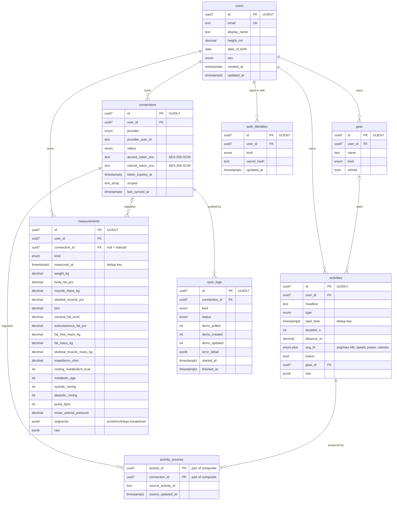

# Database schema diagram

Live rendering happens automatically in the GitHub web/file viewer.
Source of truth: `apps/server/prisma/schema.prisma` (Prisma 7 — see
[`data-model.md`](data-model.md) for column-level details and modeling
decisions).

Primary keys are **UUIDv7** on native `uuid` columns, generated by Prisma
(`@default(uuid(7))`): time-ordered identifiers — key order equals
creation order — with 16-byte binary storage.

Notes not visible in the diagram:

- `measurements` is a deliberately **wide single table** discriminated by
  `kind` — weight/body-composition and blood pressure readings share the
  shape; non-applicable columns stay NULL. See the "modeling decisions"
  section of [`data-model.md`](data-model.md).
- Dedup keys (database-enforced):
  - `connections`: `(user_id, provider, provider_user_id)`
  - `activities`: `(user_id, start_time, type, distance_m)` — the same ride
    arriving from both Strava and Garmin collapses here
  - `activity_sources`: `(activity_id, connection_id)` — how one activity
    records "known by N providers"
  - `measurements`: `(connection_id, kind, measured_at)`
- Omron body-composition value → column mapping (incl. the values omramin
  drops, like impedance and the segmental arms/trunk/legs breakdown) is
  documented in [`data-model.md`](data-model.md).
